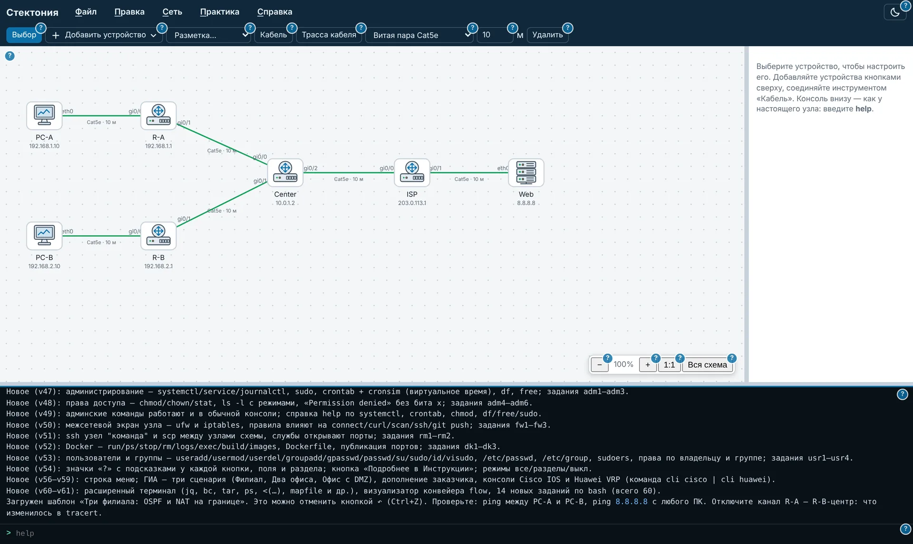
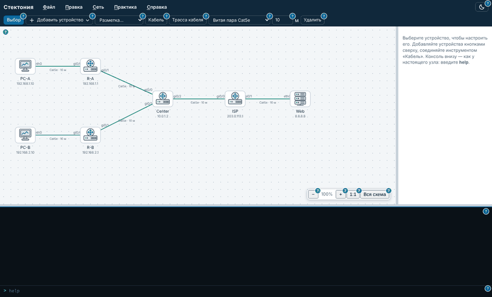
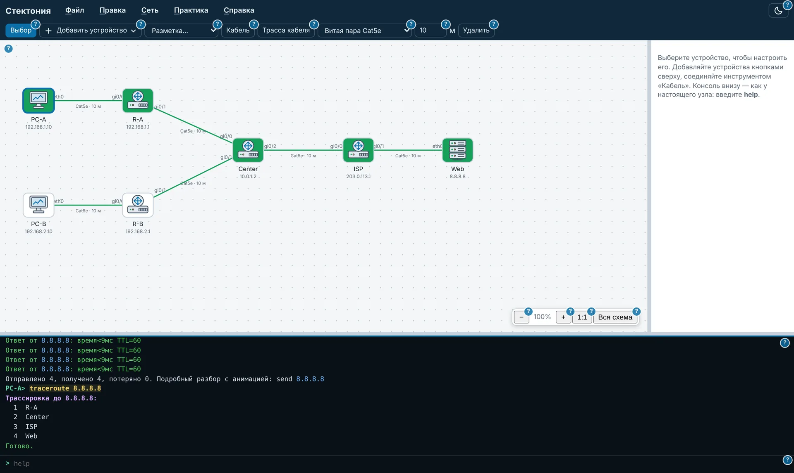
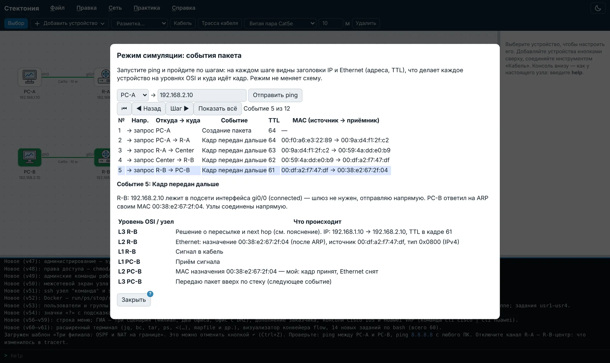
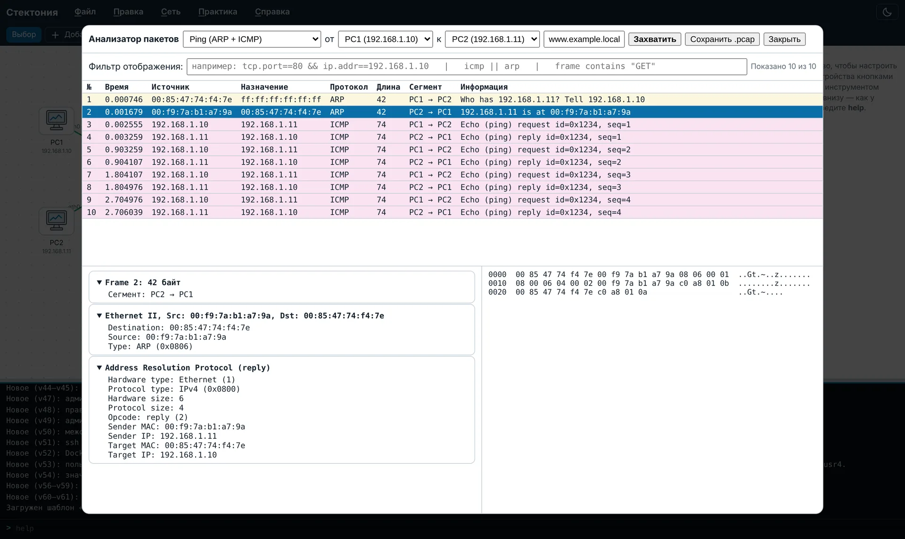
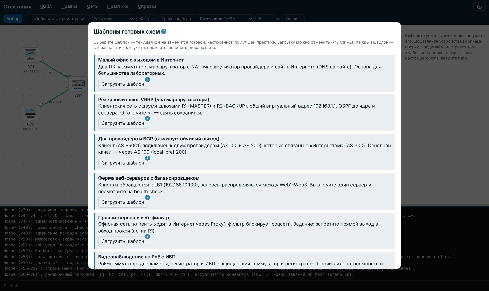
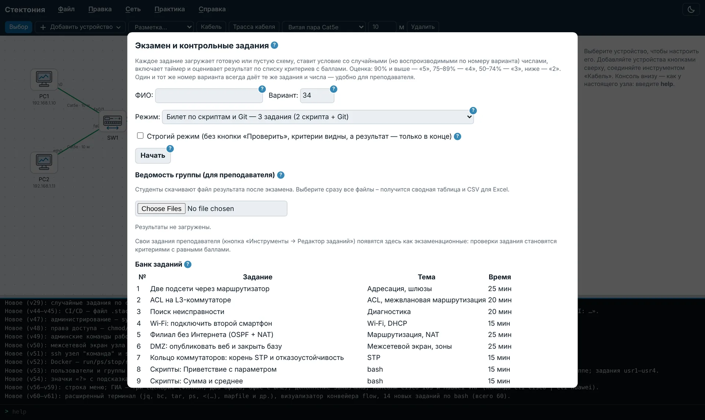
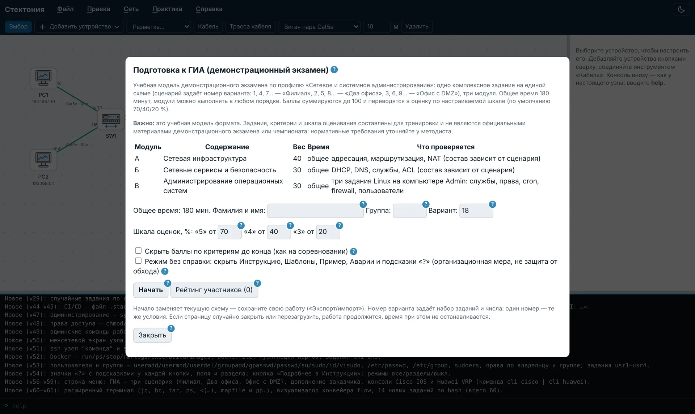
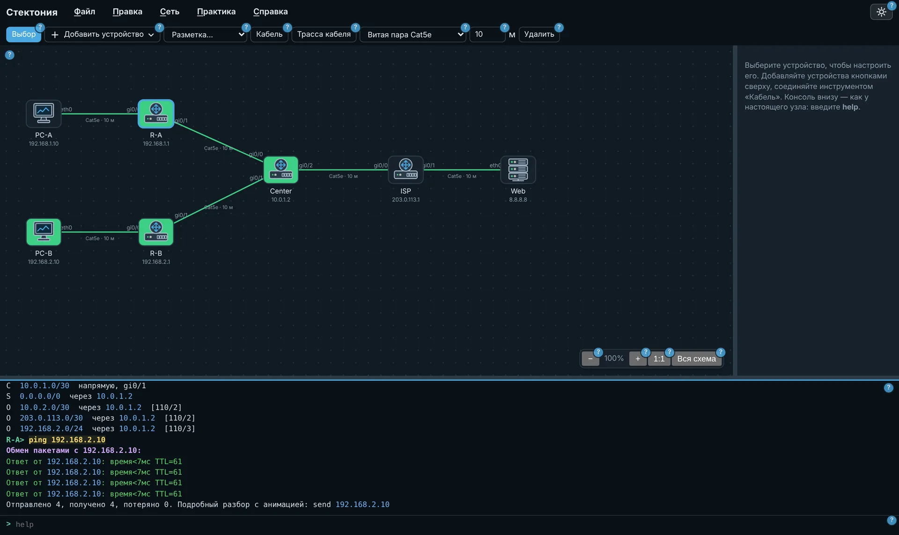

<div align="center">


# Стектония

**Сайт: <https://stacktoniya.ru/> · Симулятор: <https://stacktoniya.ru/stecktonia/>**

**Открытый сетевой симулятор и Linux-лаборатория в браузере — для СПО, ГИА, демонстрационного экзамена и реальной работы.**

[](LICENSE)




</div>

---

## Содержание

1. [Что это](#что-это)
2. [Почему «Стектония»](#почему-стектония)
3. [Возможности](#возможности)
4. [Скриншоты](#скриншоты)
5. [Быстрый старт](#быстрый-старт)
6. [Публикация на статическом хостинге](#публикация-на-статическом-хостинге)
7. [Лендинг: настройка](#лендинг-настройка)
9. [Структура репозитория](#структура-репозитория)
10. [Тесты](#тесты)
11. [Безопасность и приватность](#безопасность-и-приватность)
12. [Как помочь проекту](#как-помочь-проекту)
13. [Лицензия](#лицензия)
14. [Отказ от ответственности](#отказ-от-ответственности)

## Документация

- 📘 [`docs/Пособие_Стектония.docx`](docs/Пособие_Стектония.docx) — учебно-методическое пособие для студентов и преподавателей (152 стр., 71 лабораторная работ).
- 🛠 [`docs/Техническая_документация.md`](docs/Техническая_документация.md) — архитектура, модель данных, как добавить команду, шаблон или задание, тесты, публикация.

## Что это

«Стектония» — учебный симулятор компьютерных сетей и Linux, который целиком работает в браузере.
Он задуман как открытая замена старым настольным симуляторам вроде s2 Nettest: схемы, консоли
маршрутизаторов и коммутаторов (Cisco IOS, Huawei VRP, Eltex ESR), Linux-терминал, проверка заданий,
экзаменационные режимы и инструменты преподавателя.

Репозиторий содержит три части:

| Часть | Папка | Назначение |
|---|---|---|
| Симулятор | `stecktonia/` | Само приложение. Статические файлы, без сборки и бэкенда. |
| Лендинг | `index.html`, `styles/`, `scripts/`, `assets/` | Публичная страница проекта: описание, скриншоты, донаты, форма обратной связи. |

## Почему «Стектония»

- **Бесплатно и без регистрации.** Открыл страницу — работаешь.
- **Русский язык** во всём: интерфейс, подсказки, пособие, задания.
- **Российский контекст:** консоль Eltex, учебная модель Astra Linux (мандатный доступ), режимы ГИА и «Профессионалы».
- **Всё в одном:** сети, Linux, Docker, Git, CI, Ansible, анализатор пакетов.
- **Открытый код под AGPL** — улучшения остаются общими.

> Насколько нам известно, другого бесплатного открытого русскоязычного симулятора с таким набором возможностей нет.
> Если вы знаете — откройте issue, мы поправим формулировку.

## Возможности

- **Схемы:** компьютеры, ноутбуки, серверы, смартфоны, коммутаторы L2/L3, маршрутизаторы, межсетевые экраны, точки Wi‑Fi, камеры, ИБП и др.; кабели с типом и длиной, трассы, статусы портов.
- **Консоли:** Cisco IOS, Huawei VRP, Eltex ESR; режимы, подсказки, `show`-команды.
- **Маршрутизация и коммутация:** статические маршруты, OSPF, RIP, BGP, VRRP, BFD, VRF-lite, PBR, редистрибуция, VLAN, STP, IPv6, NAT, ACL, IP SLA.
- **Службы и безопасность:** DNS, DHCP, прокси, балансировщик, IPsec, 802.1X/RADIUS, syslog, SIEM, межсетевой экран и DMZ.
- **Linux:** bash, vim, nano, python, пользователи и права, systemd, cron, ufw/iptables, Docker, Git, CI, Ansible.
- **Режим симуляции:** пошаговый путь пакета с заголовками Ethernet/IP, ARP, TTL и объяснением по уровням OSI.
- **Анализатор пакетов:** захват, фильтры в стиле Wireshark, дерево протоколов, hex, экспорт `.pcap`.
- **Практика:** 71 лабораторная, 34 шаблона схем, аварии и поиск неисправностей, задания со скриптами.
- **Экзамены:** 23 экзаменационных задания, режимы ГИА («Филиал», «Два офиса», «Офис с DMZ») и «Профессионалы», критерии, баллы, строгий режим, рейтинг.
- **Для преподавателя:** задания с критериями, ведомость группы (CSV), режим проектора, запись и воспроизведение терминала, совместная работа без сервера.
- **Тёмная и светлая темы**, работа офлайн.

## Демо



## Скриншоты

<table>
<tr><td><br><sub>Схема сети с маршрутизаторами</sub></td><td><br><sub>Консоль устройства</sub></td></tr>
<tr><td><br><sub>Режим симуляции: уровни OSI</sub></td><td><br><sub>Анализатор пакетов</sub></td></tr>
<tr><td><br><sub>34 готовых шаблона сетей</sub></td><td><br><sub>Экзамен с таймером</sub></td></tr>
<tr><td><br><sub>Режим ГИА · ДЭ</sub></td><td><br><sub>Тёмная тема</sub></td></tr>
</table>

## Быстрый старт

**Ничего устанавливать не нужно.** Проект — чистая статика (HTML/CSS/JS), сервер не нужен.

```bash
git clone https://github.com/Giocatory/stacktoniya.git
cd stacktoniya
python3 -m http.server 8080        # любой статический сервер; можно и просто открыть index.html
```

- лендинг — <http://127.0.0.1:8080/>
- симулятор — <http://127.0.0.1:8080/stecktonia/>

## Публикация на статическом хостинге

Подойдёт любой хостинг, который отдаёт файлы: GitHub Pages, Cloudflare Pages, Netlify, обычный shared-хостинг, S3 и т. д. Серверный код не нужен.

1. Загрузите **содержимое папки `stacktoniya/`** в корень сайта (чтобы `index.html` лежал в корне).
2. Привяжите домен (A/CNAME-запись по инструкции хостинга), включите HTTPS.
3. Заполните `scripts/config.js` (см. ниже) и `privacy.html`.
4. Проверьте: главная, `/stecktonia/`, `/privacy.html`, мобильный вид.

### Домен stacktoniya.ru на reg.ru

1. В личном кабинете reg.ru откройте услугу хостинга и загрузите **содержимое** папки `stacktoniya/` (в том числе скрытый файл `.htaccess`) в каталог сайта домена `stacktoniya.ru` (обычно `www/stacktoniya.ru/`).
2. Включите SSL-сертификат (Let's Encrypt) для домена; `.htaccess` сам перенаправит http → https и www → без www.
3. Проверьте: <https://stacktoniya.ru/>, <https://stacktoniya.ru/stecktonia/>, <https://stacktoniya.ru/robots.txt>, <https://stacktoniya.ru/sitemap.xml>, несуществующий адрес (должна открыться страница 404).
4. Добавьте сайт в Яндекс Вебмастер и Google Search Console (файл sitemap уже готов).

Для GitHub Pages: Settings → Pages → Deploy from branch → `main` / `(root)`.

## Лендинг: настройка

Все ссылки и реквизиты задаются в одном файле — [`scripts/config.js`](scripts/config.js). Пустые значения скрывают соответствующие кнопки.

```js
window.STACK_CONFIG = {
  repo: "https://github.com/Giocatory/stacktoniya",
  github: "https://github.com/Giocatory",
  tenchat: "https://tenchat.ru/<аккаунт>",
  donate: { sbp: "https://…", card: "…", cardLabel: "Карта •• 1234", boosty: "", yoomoney: "", crypto: "" },
  publicEmail: "python@derkunov.ru"
};
```


Лендинг написан на чистых HTML/CSS/JS, шрифты (Manrope и JetBrains Mono, SIL OFL) лежат локально в `assets/fonts/` — внешних CDN и трекеров нет.


## Структура репозитория

```
stacktoniya/
├── stecktonia/      симулятор (бывший NetLab): index.html, scripts/{core,layers,modules}, styles/, pages/
├── docs/            Пособие_Стектония.docx и Техническая_документация.md
├── assets/          логотип, шрифты, скриншоты
├── styles/          стили лендинга и подключение шрифтов
├── scripts/         скрипты лендинга и config.js
├── index.html       лендинг
├── tests/               автотесты симулятора (jsdom)
├── 404.html, robots.txt  страница ошибки и правила для поисковиков
├── privacy.html     шаблон политики конфиденциальности
├── favicon.ico
├── LICENSE          GNU AGPL-3.0-or-later
└── ReadMe.md
```

## Тесты

Симулятор покрыт автотестами (jsdom, без браузера): 59 файлов, около 1 000 проверок.

```bash
cd tests
npm install
npm test
```

Описание — в [`tests/README.md`](tests/README.md).

## Безопасность и приватность

- Симулятор не отправляет данные: схемы и результаты хранятся только в браузере пользователя.
- Собственного сервера и форм сбора данных нет: сайт ничего не собирает. Контакты автора — в блоке «Контакты» на лендинге.
- Если вы нашли уязвимость, напишите автору приватно (контакт — на лендинге/в профиле GitHub), не создавая публичный issue.
- Криптография в симуляторе — **учебная модель**, не предназначенная для защиты реальных данных.

## Как помочь проекту

- ⭐ Поставьте звезду и расскажите коллегам и студентам.
- 🐞 Сообщайте об ошибках (issue на GitHub или любой контакт с сайта): версия, шаг воспроизведения, ожидаемое и фактическое поведение.
- 💡 Предлагайте лабораторные, шаблоны, команды консолей.
- 🔧 Присылайте pull request-ы. Так как лицензия AGPL, отправляя код, вы соглашаетесь на его распространение на тех же условиях.
- ❤ **Поддержите финансово** — реквизиты указаны на лендинге в блоке «Поддержать развитие». Деньги идут на домен, хостинг и время разработки.

## Лицензия

Copyright © Стектония, участники проекта.

Распространяется на условиях **GNU Affero General Public License v3.0 или более поздней** (`AGPL-3.0-or-later`), см. [LICENSE](LICENSE).
Если вы изменяете проект и предоставляете его пользователям (в том числе по сети, как сайт), вы обязаны предоставить им исходный код своей версии на тех же условиях.

Шрифты Manrope и JetBrains Mono — SIL Open Font License 1.1 (файлы лицензий лежат в `assets/fonts/`).

## Отказ от ответственности

Программа предоставляется «как есть», без каких-либо гарантий. Симулятор — **учебная модель** и не заменяет реальное оборудование.
Cisco, Huawei, Eltex, Astra Linux, Wireshark и другие названия принадлежат их правообладателям и используются только для обозначения
совместимого синтаксиса; проект не связан с этими компаниями. Режимы ГИА, демонстрационного экзамена и «Профессионалы» — учебные модели формата,
а не официальные материалы; официальные задания и критерии уточняйте у организатора.

## Контакты

- TenChat: <https://tenchat.ru/giocatory>
- GitHub: <https://github.com/Giocatory>
- Telegram: @Giocatory
- Max: +7 996 584-54-47
- Email: python@derkunov.ru
